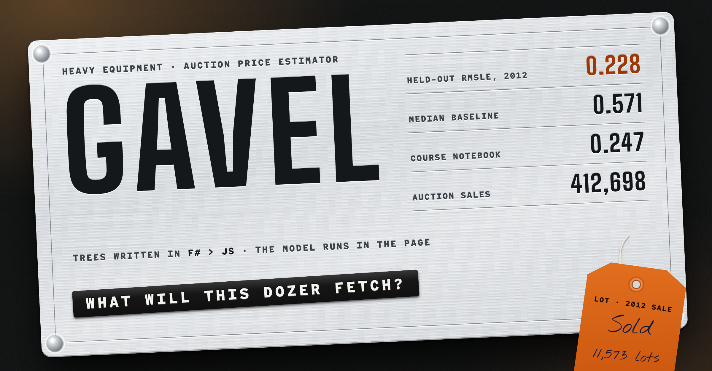

# Gavel

Estimating what a used bulldozer, excavator or loader will fetch at auction, with gradient-boosted trees and a random forest written from scratch in F#. The same F# prediction code runs on .NET for training and, compiled to JavaScript by Fable, in the browser.

**[Try the demo](https://evannwilsonn.github.io/gavel/)**: describe a machine on its data plate and get an estimated hammer price, a range, and what moved it. "Pull a real 2012 sale" loads one of the held-out auctions and shows what it actually sold for.

On **11,573 auction sales from January to April 2012**, held back until the end, the final model scores an **RMSLE of 0.228**: half its estimates are within 13% of the hammer price. The best simple baseline, the median price of the same base model and year, scores 0.391. The Zero to Mastery course notebook's random forest reports 0.247 on the same sales, but it chose its settings by scoring them on those sales; Gavel chose everything on late-2011 sales and opened 2012 once.

The project follows seven steps: problem, data, baseline, model, evaluation, improvement and deployment.



---

## 1. Problem

Given what an auction listing says about a machine (what it is, its model, when it was made, its hours, where and when it's sold, how it's equipped), predict the hammer price. That's regression on about 400,000 past sales.

- **The metric is RMSLE**, the Kaggle competition's: the root mean squared difference between log(1 + estimate) and log(1 + price). It scores ratios, so being 20% off a $10,000 skid steer counts the same as 20% off a $200,000 dozer. Because of that, every model here is trained on log(1 + price) directly.
- **The split is by time**, not at random: the job is to price sales that haven't happened yet, and prices drift. A random split would let a model learn from sales a week after the one it's pricing.
- The demo also needs a range and a reason, not just a number.

## 2. Data

Kaggle's [Blue Book for Bulldozers](https://www.kaggle.com/c/bluebook-for-bulldozers) competition data (Fast Iron, 2013), as copied into the course repo. Kaggle's rules don't allow redistributing it, so it isn't committed: [`scripts/get-data`](scripts/get-data) fetches the course's zip and extracts the three files used. Details, checksums and how each column is read are in [data/README.md](data/README.md).

| Set | Sales | Dates | Used for |
|---|---|---|---|
| Fitting window | 390,213 | 1989 to 31 Aug 2011 | fitting every model while choosing settings |
| Tuning window | 10,912 | 1 Sep to 31 Dec 2011 | choosing settings (four months, like the held-out set) |
| Final fit | 401,125 | 1989 to 31 Dec 2011 | the final models (`Train.csv`) |
| **Held out** | **11,573** | **1 Jan to 30 Apr 2012** | scored once at the end (`Valid.csv` + `ValidSolution.csv`) |

Kaggle's test period (May to November 2012) has no published prices in the course's copy, so it isn't used.

What the reading has to deal with:

- **Missing values are the norm.** `YearMade` is the placeholder 1000 for 9.5% of sales, and 83% have no hours reading (blank or 0). Most option columns are blank outside one or two product groups. All of these are kept as "missing", which trees can split on.
- **Dates** (`11/16/2006 0:00`) become year, month, day, day of week and day of year, as in the course.
- **Every text column is a category** (46 of them, from `ProductGroup` with 6 values to `fiModelDesc` with about 5,000). Codes are their position in alphabetical order (step 6 explains why not by price). `SalesID` and `MachineID` are left out.
- Feature encoding lives in [`src/Core/Features.fs`](src/Core/Features.fs), the code the browser runs too, so training and the page can't disagree on what a column means.

## 3. Baseline

Medians of the fitting sales' prices, with no model ([`Baselines.fs`](src/Train/Baselines.fs)):

| RMSLE | Tuning window (late 2011) | Held out (early 2012) |
|---|---|---|
| Median price of all sales | 0.731 | 0.744 |
| Median by product group | 0.605 | 0.622 |
| Median by product group and year made (20+ sales, else group) | 0.548 | 0.571 |
| Median by base model and year made (5+ sales, else the above) | 0.394 | 0.391 |

Knowing the exact model and year already gets a long way. The models have to beat 0.39.

## 4. Model

Both learners are written from scratch in F# ([`src/Train`](src/Train)) on one tree builder ([`TreeBuilder.fs`](src/Train/TreeBuilder.fs)):

- **Binned features.** Each feature is cut into at most 255 bins (4,096 for categories) at quantiles of the fitting data, with bin 0 for missing ([`Binning.fs`](src/Train/Binning.fs)). A node finds its best split by filling a histogram of its rows' bins and scanning it, as LightGBM does. Nodes with few rows and many bins sort instead.
- **Split rule.** A node's value is sum(y) / (count + λ), and a split's gain is the drop in squared error. With λ = 0 that is exactly a CART regression tree's variance reduction. Missing values always go left, with the lowest values. Leaves are split best-gain first until the leaf limit.
- **Gradient boosting** ([`Learners.fs`](src/Train/Learners.fs)): each tree fits the current residuals on a 70% sample of rows and 80% of features, shrunk by the learning rate. The number of trees is chosen by watching the tuning window, stopping 250 trees after the last improvement.
- **Random forest**: bootstrap samples of every row, half the features tried at each split, trees grown to leaves of 2, predictions averaged. These are close to the course's final settings (90 trees, `max_features=0.5`, `min_samples_split=5`).

**Checked against ML.NET.** The same features and settings through ML.NET's LightGBM, FastTree and FastForest ([`MlNetCheck.fs`](src/Train/MlNetCheck.fs)):

| RMSLE, tuning window | Gavel (F#) | ML.NET |
|---|---|---|
| Boosting, 1,348 trees, 255 leaves, rate 0.05 | **0.2232** | LightGBM 0.2260, FastTree 0.2259 |
| Random forest, 90 trees | **0.2337** | FastForest 0.2386 |

The from-scratch learners land within 0.003 to 0.005 of the library versions, slightly ahead. They are much slower: 5 minutes for the boosted model on two cores against LightGBM's 38 seconds. One thing the check turned up: ML.NET's FastTree refuses rows with any missing value ("All instances skipped due to missing features"), and its LightGBM scored 1.02 when given NaNs. Both were fed missing values as −1 instead, which sorts them below every real value, the same as Gavel's "missing goes left".

## 5. Evaluation

Everything was chosen on the tuning window ([`results/tuning.json`](results/tuning.json)), then the final models were refit on all of `Train.csv` and scored once on the 2012 sales ([`results/holdout.json`](results/holdout.json)):

| Held out: 11,573 sales, Jan to Apr 2012 | RMSLE | Median miss | MAE | R² (dollars) |
|---|---|---|---|---|
| **Final: 0.75 × boosting + 0.25 × forest** | **0.228** | **13.1%** | **$5,681** | **0.885** |
| Boosting alone (F#) | 0.230 | 13.2% | $5,722 | 0.884 |
| Random forest alone (F#) | 0.238 | 13.8% | $5,922 | 0.874 |
| ML.NET FastTree, same settings | 0.232 | 13.3% | $5,728 | 0.885 |
| ML.NET LightGBM, same settings | 0.233 | 13.4% | $5,752 | 0.883 |
| ML.NET FastForest | 0.246 | 15.1% | $6,390 | 0.853 |
| Browser model (step 7) | 0.256 | 15.5% | $6,538 | 0.849 |
| Median by base model and year made | 0.391 | 19.3% | $8,966 | 0.715 |
| Course notebook's forest (its own report) | 0.247 | | $5,979 | 0.881 |

- **Against the course.** Its 0.247 comes from the same 2012 sales, but its random search and its "ideal" settings were judged on those sales, so it is a tuned score, not a held-out one. Gavel's forest alone, with nearly the same settings but fit on log prices, gets 0.238. Boosting and the blend take it to 0.228. The gap is real but modest, and part of it is the log target rather than anything clever.
- **Tuning window to held out:** 0.222 became 0.228. Some loss is expected: the held-out sales are further from the training data.
- **Training RMSLE is 0.135**, so the model fits its own data much better than new sales. That gap is normal for boosted trees on noisy prices; the tuning window, not training error, picked the tree count.

**What drove the errors** ([`results/errors.json`](results/errors.json)):

| Held-out slice | Sales | RMSLE |
|---|---|---|
| Model never sold before 2012 | 93 | 0.395 |
| 1 to 9 earlier sales of the model | 533 | 0.266 |
| 100+ earlier sales of the model | 8,338 | 0.216 |
| Year made unknown | 1,206 | 0.317 |
| Made 2000 or later | 6,385 | 0.198 |
| Hours not recorded / recorded | 7,542 / 4,031 | 0.234 / 0.216 |
| Backhoe loaders (best group) | 1,986 | 0.176 |
| Dozers (worst group) | 2,062 | 0.255 |

- **New models are the hardest case**, and they're also priced 15% too low on average: with no history the trees fall back on the size class and year, and new models tend to be the expensive ones.
- **An unknown year made** costs more accuracy than missing hours. Year made is the strongest feature by a distance (mean effect ±0.24 in log price, then the coupler system, size class, product size and sale year at 0.11 to 0.14).
- **Prices drifted.** The estimates ran 5.3% low in January 2012 and 1 to 1.6% low in February to April. Trees can't extrapolate a trend past the last sale they saw.
- **The worst misses look like data problems**: a 2008 IT28F wheel loader sold for $11,000 (estimate $59,800), excavators with no year made sold for four or five times the estimate. A listing doesn't always describe the machine that crossed the block.

## 6. Improvement

What was tried on the tuning window, one question at a time (quick boosting at rate 0.1 for the first two):

| Question | Options (tuning RMSLE) | Kept |
|---|---|---|
| Category codes | by average price 0.2459, **alphabetical 0.2304** | alphabetical |
| Extra columns | **none 0.2292**, + age at sale and a time trend 0.2304, + `SalesID` and `MachineID` 0.2328 | none |
| Boosting shape (rate 0.05) | 63 leaves 0.2244, **255 leaves 0.2232**, 127 leaves with half the features 0.2234 | 255 leaves |
| Forest | **min leaf 2, half the features 0.2337**, min leaf 5, a third 0.2359 | min leaf 2 |
| Blend weight on boosting | 0 → 0.2337, 0.25 → 0.2270, 0.5 → 0.2230, **0.75 → 0.2217**, 1 → 0.2232 | 0.75 |

What didn't work:

1. **Ordering category codes by average price** is a standard trick for trees (it lets one split separate cheap models from dear ones), and it did clearly worse. The codes are computed from the same rows the trees then fit, so each model's own prices leak into its code and the trees trust it too much. Rare models suffer most, and that is exactly where the held-out errors are.
2. **Age at sale and a continuous time trend** didn't help: the trees already combine year made with sale year, and a trend feature still can't be extrapolated by trees.
3. **The identifiers** (`SalesID`, `MachineID`) that the course feeds in made things slightly worse. They're time-ordered, so they mostly encode sale date again, noisily.
4. The extra leaves helped less than expected (0.2244 to 0.2232), and the blend's gain (0.0015) is small. Most of the improvement over the baseline is simply trees on the right columns, on a log target.

The whole run is a few commands ([`scripts/train`](scripts/train), about an hour on two cores). Each writes its part of [`results/`](results):

```sh
./scripts/get-data
dotnet build src/Train -c Release
dotnet src/Train/bin/Release/net8.0/Gavel.Train.dll tune      # 2011 tuning window only
dotnet src/Train/bin/Release/net8.0/Gavel.Train.dll mlnet     # the ML.NET check
dotnet src/Train/bin/Release/net8.0/Gavel.Train.dll holdout   # opens the 2012 prices
dotnet src/Train/bin/Release/net8.0/Gavel.Train.dll demo      # the browser model
```

Every learner is seeded, so the numbers repeat exactly. ML.NET's LightGBM needs `libgomp1` (it's on GitHub's Ubuntu runners; the `mcr.microsoft.com/dotnet/sdk` image doesn't have it).

## 7. Deployment

The prediction code ([`src/Core`](src/Core)) is plain F# with no .NET-only dependencies: tree evaluation, the path-based explanation, feature encoding, and the estimate with its range. Training references it as a .NET library. For the page, [Fable](https://fable.io) compiles it to JavaScript, and esbuild bundles that with the page script ([`web/app.js`](web/app.js), which only builds the form and draws) into [`docs/gavel.js`](docs/gavel.js), 37 KB. There is no server, and nothing typed into the page leaves it.

- **The browser model** is a separate, smaller boosted model trained only on what a visitor can describe: product group, base model, series, size class, year made, hours, state, cab, one or two options per group, and the sale date (17 features). 400 trees of up to 48 leaves, 38,000 nodes, 798 KB of JSON ([`docs/model.json`](docs/model.json)). Its settings were fixed before it was scored. On the held-out sales it scores **0.256 RMSLE** ([`results/demo.json`](results/demo.json)), against 0.228 for the full model, which also sees ModelID, the auctioneer and dozens of equipment columns.
- **The range** is the spread of the browser model's errors on the tuning window, per product group: the 10th to 90th percentile of log(price) − log(estimate). On the held-out sales, **77% of prices fell inside it** (73% to 80% by group), a little short of the 80% it was built for, because 2012 prices sat slightly below the estimates.
- **What moved the price** splits each estimate into a start (the average training sale, in log space) plus one effect per field, by following the machine's path through every tree and crediting each change in node value to the feature that node split on (Saabas attribution). The effects add up exactly to the estimate, and the page shows each as a percentage.
- **Parity:** [`scripts/check-js.mjs`](scripts/check-js.mjs) runs the Fable build in Node on 43 machines (36 real 2012 sales and 7 hand-made edge cases: blank fields, unknown models, a 2015 sale date) and compares with the .NET answers in [`results/parity.json`](results/parity.json). The largest difference is 0, and the explanations add up to within 4e-15.

```sh
./scripts/build-js                                            # Fable + esbuild -> docs/gavel.js
dotnet src/Train/bin/Release/net8.0/Gavel.Train.dll page      # web/template.html + results/ -> docs/index.html
./scripts/test.sh                                             # unit tests, Fable build, JS/.NET parity (what CI runs)
python3 scripts/check-page.py                                 # Playwright: both themes, 1280 and 375 px
python3 scripts/thumbnail.py                                  # .github/thumbnail.png
```

The page is built around a machine's riveted data plate. The design notes are in [web/DESIGN.md](web/DESIGN.md).

## Layout

```
src/Core/   F# shared by training and the page: trees, explanations, features, estimate (Fable-compatible)
src/Train/  CSV reading, binning, the tree builder, boosting, forest, baselines, ML.NET check, experiments, page build
tests/      xUnit tests for both
web/        the page template, the page script and the design notes
docs/       the GitHub Pages demo
results/    every number in this README
scripts/    get-data, train, build-js, test.sh, check-js.mjs, check-page.py, thumbnail.py
```

## Credits

- **Course:** the project comes from Daniel Bourke's [Zero to Mastery Machine Learning](https://github.com/mrdbourke/zero-to-mastery-ml) course, notebook `section-3-structured-data-projects/end-to-end-bluebook-bulldozer-price-regression-v2.ipynb`. This is my own rebuild in a different language, not a port of the notebook.
- **Data:** [Blue Book for Bulldozers](https://www.kaggle.com/c/bluebook-for-bulldozers), Kaggle competition by Fast Iron (2013). Used under the competition's rules and not redistributed here; the demo includes a small derived catalogue of model names and 36 example sales.
- **Libraries:** [Fable](https://fable.io) (F# to JavaScript), [ML.NET](https://dot.net/ml) (the library check), xUnit, esbuild.
- **Fonts:** Big Shoulders, Red Hat Mono and Nothing You Could Do, under the SIL Open Font License (`docs/fonts/`).
- **License:** MIT for the code ([LICENSE](LICENSE)).
